<p align="center">
  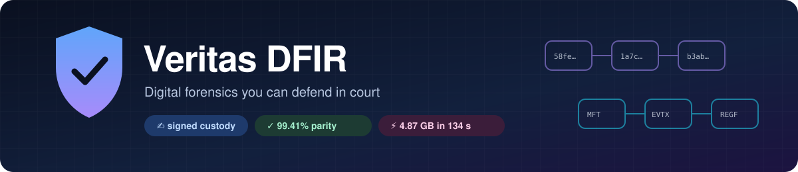
</p>

<p align="center">
  <a href="docs/PARITY.md"></a>
  <a href="docs/BENCHMARKS.md"></a>
  <a href="docs/THREAT_MODEL.md"></a>
  
  <a href="LICENSE"></a>
</p>

<p align="center">
  <b>Acquire</b> evidence with verifiable hashes · <b>parse</b> disk, memory, mobile, cloud and network artifacts ·
  <b>investigate</b> one unified timeline · <b>prove</b> every step with a signed custody chain · <b>report</b> reproducibly
</p>

---

<p align="center">
  <picture>
    <source media="(prefers-color-scheme: dark)" srcset="docs/images/ui/dashboard-dark.png">
    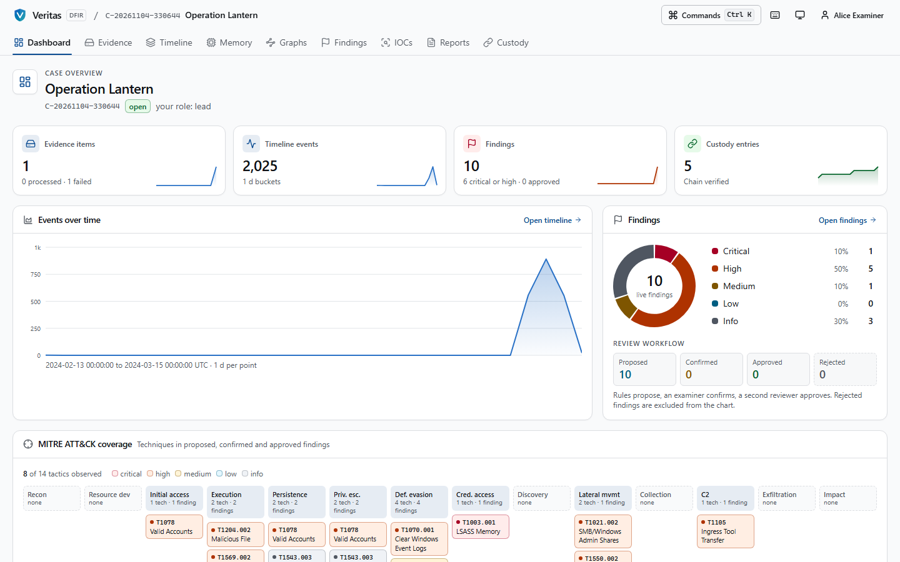
  </picture>
</p>

## Why Veritas

| | |
|---|---|
| 🔏 **Custody you can verify offline** | Every read, parse, extraction, export and report is an Ed25519-signed, hash-chained ledger entry. `veritas-verify` re-checks the whole chain with no access to the platform and prints **PASS** or **FAIL**. |
| 🧪 **Parsers with a published error rate** | 68 parsers compared field by field with The Sleuth Kit, libyal, Plaso, dissect, scapy and LIEF: **99.41% agreement over 1.48 million comparisons**. Every gap is explained; CI blocks regressions. |
| 🛡️ **Built for hostile evidence** | Memory-safe Rust parsers, 14 fuzz targets, sandboxed workers with memory and time caps and no network. Fuzzing found and fixed a real overflow. |
| 👥 **Humans decide** | Analytics only *propose* findings. An examiner confirms with a rationale; a different reviewer approves. Reports are byte-identical when regenerated. |
| 💻 **Runs on a laptop** | Native mode needs no containers. A real 4.87 GB intrusion image is processed end to end in **134 seconds**. |

## Tour of the examiner app

<table>
  <tr>
    <td width="50%">
      <picture>
        <source media="(prefers-color-scheme: dark)" srcset="docs/images/ui/timeline-dark.png">
        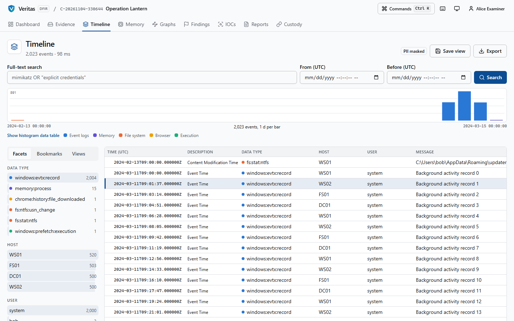
      </picture>
      <p align="center"><b>Super-timeline</b><br><sub>Full-text search, histogram brushing, facets, pivots, PII masking, event provenance</sub></p>
    </td>
    <td width="50%">
      <picture>
        <source media="(prefers-color-scheme: dark)" srcset="docs/images/ui/graph-dark.png">
        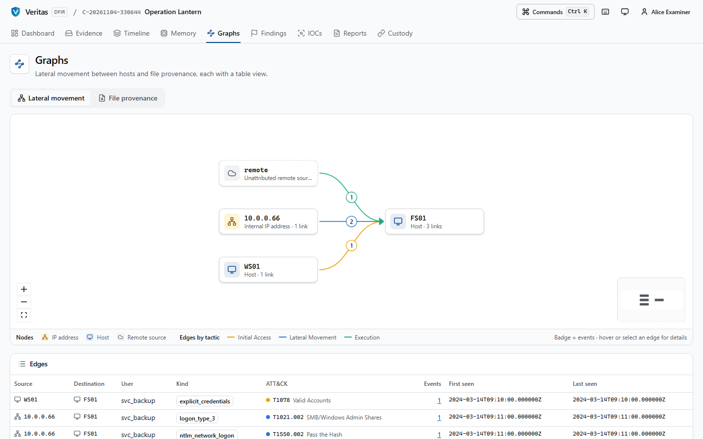
      </picture>
      <p align="center"><b>Lateral movement graph</b><br><sub>Logons, explicit credentials, remote services, ATT&amp;CK-coloured edges</sub></p>
    </td>
  </tr>
  <tr>
    <td width="50%">
      <picture>
        <source media="(prefers-color-scheme: dark)" srcset="docs/images/ui/findings-dark.png">
        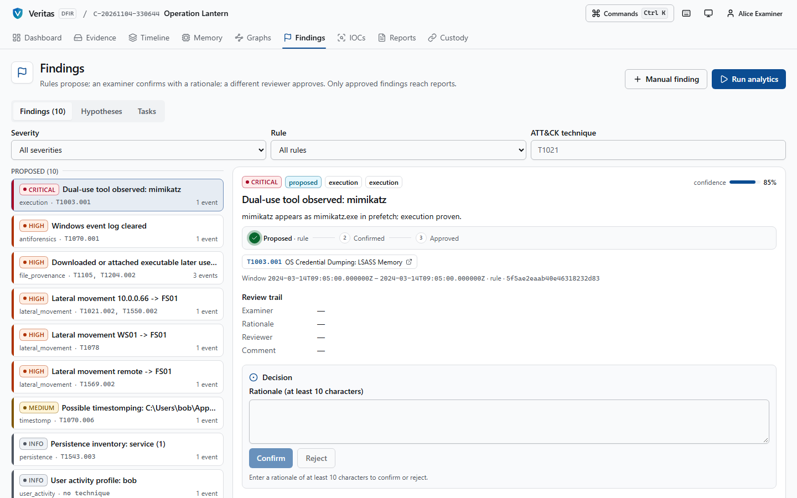
      </picture>
      <p align="center"><b>Findings workspace</b><br><sub>Proposed → confirmed → approved, with supporting events and techniques</sub></p>
    </td>
    <td width="50%">
      <picture>
        <source media="(prefers-color-scheme: dark)" srcset="docs/images/ui/custody-dark.png">
        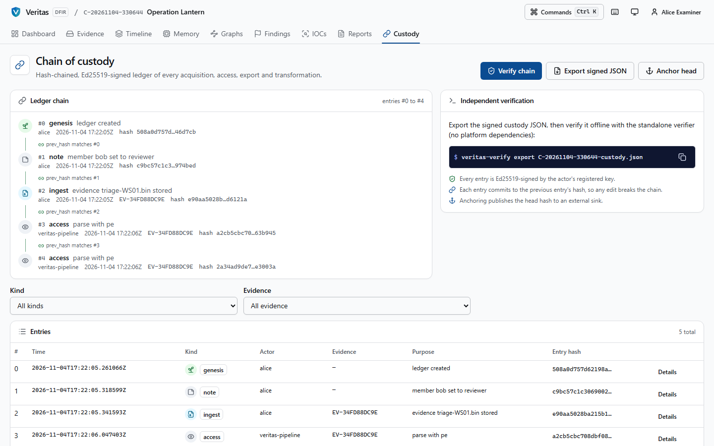
      </picture>
      <p align="center"><b>Custody ledger</b><br><sub>Every entry signed and linked; one-click verification and signed export</sub></p>
    </td>
  </tr>
  <tr>
    <td width="50%">
      <picture>
        <source media="(prefers-color-scheme: dark)" srcset="docs/images/ui/memory-dark.png">
        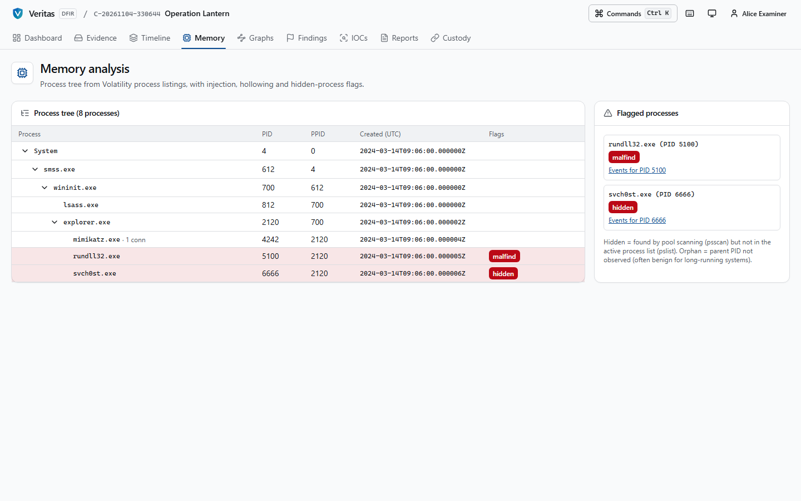
      </picture>
      <p align="center"><b>Memory analysis</b><br><sub>Process tree with injection, hollowing and hidden-process flags</sub></p>
    </td>
    <td width="50%">
      <picture>
        <source media="(prefers-color-scheme: dark)" srcset="docs/images/ui/evidence-dark.png">
        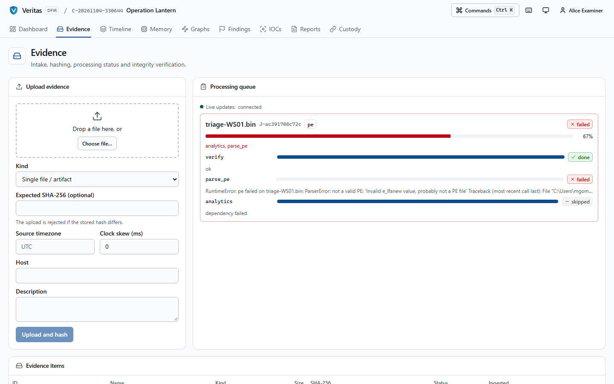
      </picture>
      <p align="center"><b>Evidence intake</b><br><sub>Hash-checked upload, live processing progress, hex viewer</sub></p>
    </td>
  </tr>
</table>

<details>
<summary><b>More screens</b>: cases, IOCs, reports, login</summary>
<br>

| Cases | IOC manager |
|---|---|
| 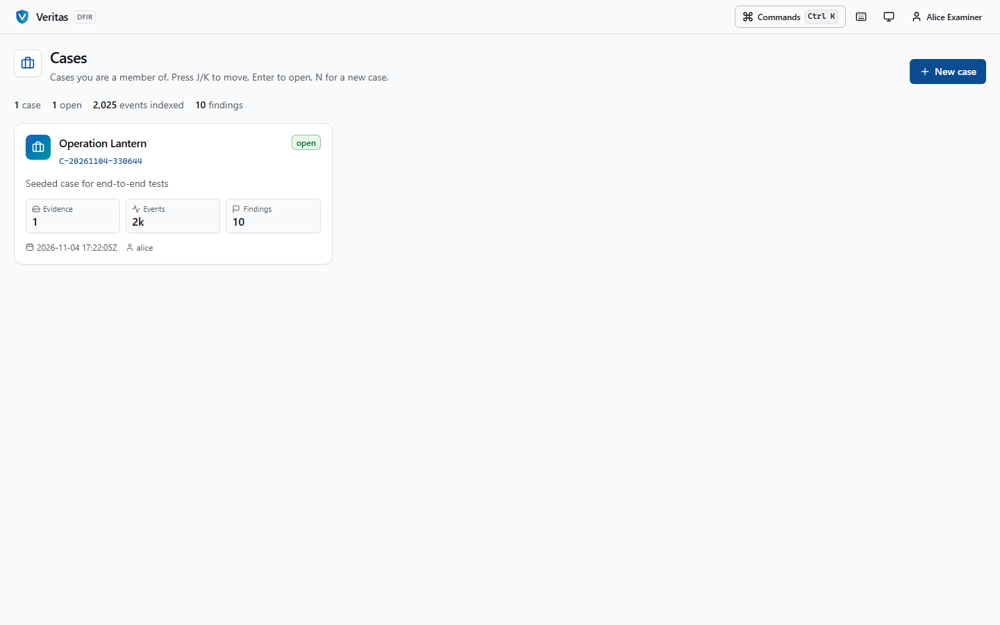 | 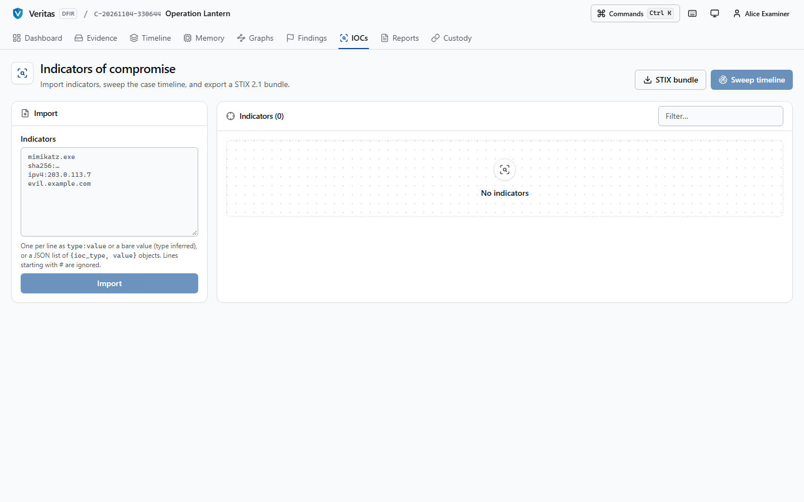 |
| **Reports** | **Sign in** |
| 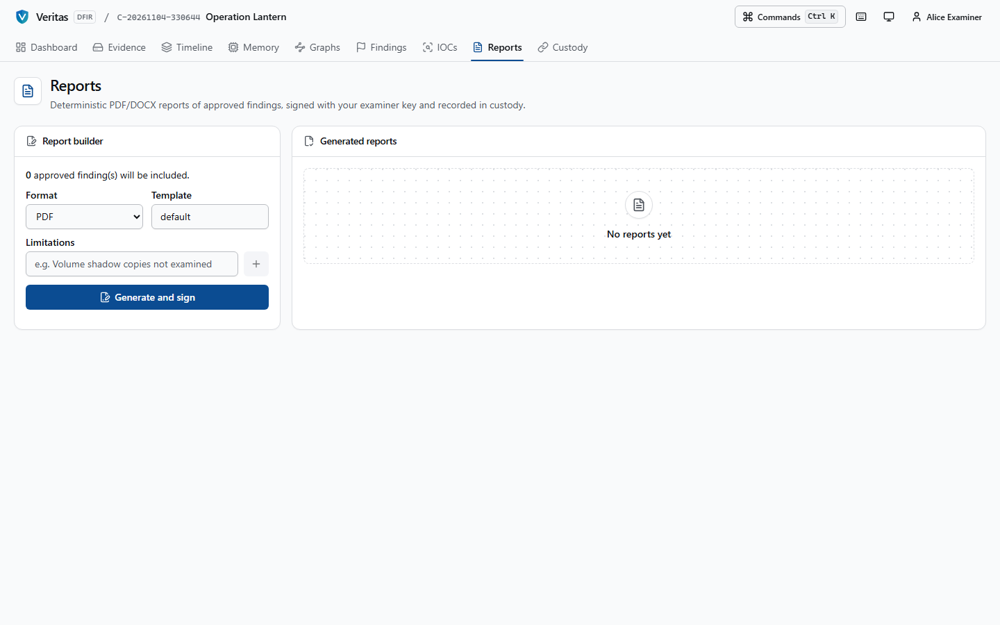 | 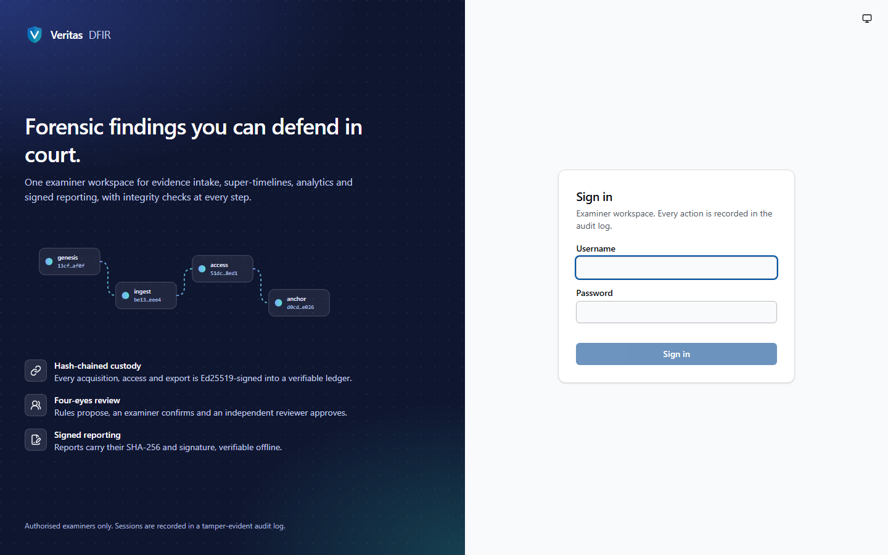 |

</details>

Keyboard-first: <kbd>Ctrl</kbd>+<kbd>K</kbd> command palette, <kbd>g</kbd> <kbd>t</kbd> timeline, <kbd>/</kbd> search, <kbd>j</kbd>/<kbd>k</kbd> move, <kbd>b</kbd> bookmark, <kbd>?</kbd> all shortcuts.
Light and dark themes, WCAG 2.2 AA, Lighthouse 100 on the audited pages, zero serious axe violations in the browser test suite.

## Quickstart

No containers needed. Requirements: Python 3.12 (64-bit), Rust 1.80+, Node 20+.

```powershell
powershell -ExecutionPolicy Bypass -File scripts\bootstrap\quickstart.ps1 -Intrusion
```

```bash
scripts/bootstrap/quickstart.sh --intrusion
```

The script builds everything, starts the API on `http://127.0.0.1:8000`, downloads public reference
data and the NIST *Hacking Case* laptop image (1.1 GB, hash-pinned), processes it, prints the proposed
findings, generates a signed report and verifies the custody export:

```text
[high]   Dual-use tool observed: cain         prefetch + ShimCache + UserAssist, execution proven
[high]   Dual-use tool observed: ethereal     packet capture (T1040)
[high]   Dual-use tool observed: netstumbler  wireless discovery
[high]   Dual-use tool observed: lookatlan    network service discovery (T1046)
[medium] Dual-use tool observed: anonymizer   proxy (T1090)

[8/8] custody
  veritas-verify: entries checked:    263
  veritas-verify: signatures checked: 264
  veritas-verify: PASS
```

Then open the UI:

```bash
cd web && npm ci && npm run build && npm start
```

Drop `--intrusion` for a one-minute run on small public test artifacts.

## How it works

<p align="center">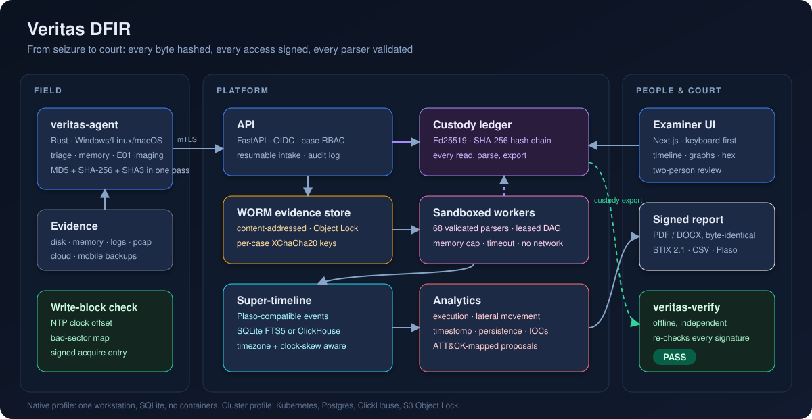</p>

<p align="center">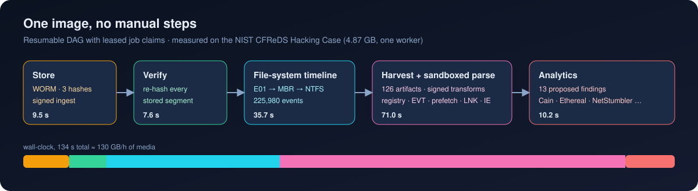</p>

### Chain of custody

<p align="center">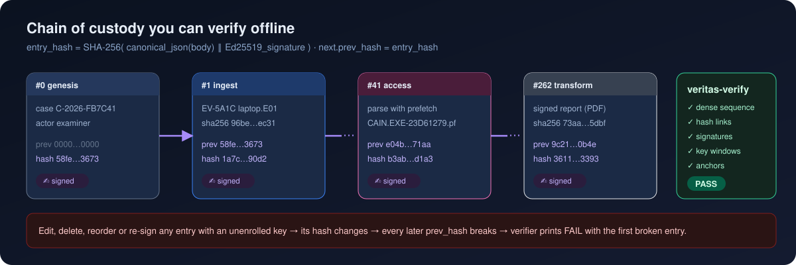</p>

Verify any export yourself:

```bash
target/release/veritas-verify export var/bootstrap/<case>-custody.json
```

### Validation and performance

<p align="center">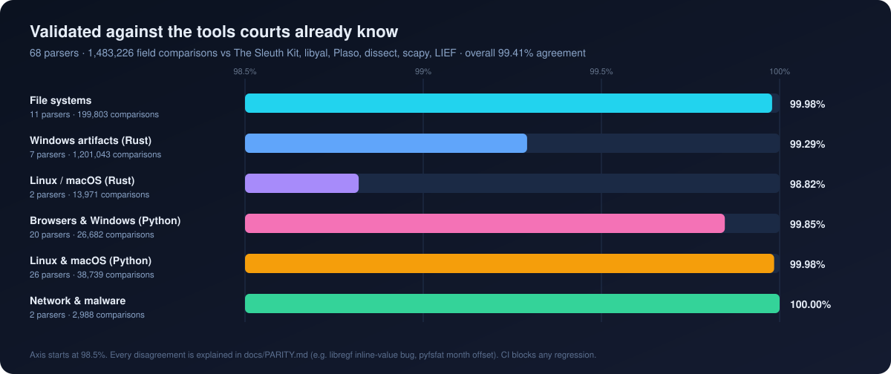</p>

<p align="center">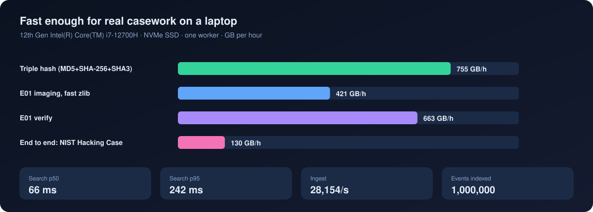</p>

## What is in the box

| Area | Components |
|---|---|
| 🧲 Acquisition | `veritas-agent`: live triage, raw NTFS `$MFT`/`$LogFile`/`$UsnJrnl`, E01 imaging with triple hashing and bad-sector maps, write-block check, WinPmem/LiME/osxpmem, resumable mTLS upload |
| 💽 File systems | NTFS (ADS, `$I30` slack, USN, `$LogFile`, timestomp), FAT/exFAT, ext2/3/4, APFS, VSS, MBR/GPT, carving, BitLocker/LUKS/APFS decryption, E01 and split raw |
| 🪟 Windows | registry with log replay and deleted cells, UserAssist, ShellBags, MRUs, USB, ShimCache, Amcache, BAM, autoruns, EVTX/EVT, prefetch to Win11, LNK, jump lists, SRUM, browsers, PST, Office, Recycle Bin, WMI |
| 🐧 Linux / 🍎 macOS | journald, syslog, auditd, utmp, shell history, cron, systemd, SSH; unified logs, FSEvents, KnowledgeC, plists, quarantine, TCC, launch agents, ASL, BSM |
| 🧠 Memory · 🌐 Network · 🦠 Malware | Volatility 3 with injection, hollowing and credential-access heuristics; pcap flows, DNS, HTTP, TLS JA3, Zeek; PE/ELF/Mach-O, Authenticode, YARA, VirusTotal, MalwareBazaar, CAPE/Cuckoo |
| ☁️ Cloud · 📱 Mobile | CloudTrail, S3, ELB, Azure/Entra, Google Workspace, M365 UAL; iOS backups, Android ADB backups and pulls |
| 🔎 Analysis | timezone and skew correction, execution correlation, lateral movement, persistence, file provenance, IOC sweeps, ATT&CK mapping |
| 📄 Reporting | deterministic signed PDF/DOCX, STIX 2.1, CSV, JSON Lines, Plaso |
| ⚙️ Operations | Helm, Kubernetes manifests, Terraform for AWS, GitHub Actions with signing and SBOM, Grafana, Prometheus alerts, verified backup and restore |

## Repository layout

```text
crates/            Rust: hash, ledger + veritas-verify, store, ewf, agent, fs, artifacts, timeline, cli
python/veritas/    API, pipeline, parsers, memory, network, malware, cloud, mobile, analytics, reporting
web/               examiner web application (Next.js 15, TypeScript strict)
deploy/            container files, Helm chart, Kubernetes manifests, Terraform, observability
scripts/           bootstrap, backup/restore, parity, determinism, fuzzing, benchmarks, charts
docs/              architecture, threat model, compliance, parsers, runbooks, paper, images
```

## Tests

| Suite | Count |
|---|---|
| Rust unit, corpus and property tests | 243 |
| Python tests (91% line coverage) | 713 |
| Parity result sets | 68 |
| Web unit tests | 106 |
| Browser end-to-end tests with axe | 26 |
| Fuzz targets | 14 |

```bash
python testdata/fetch.py && cargo test --workspace --locked
.venv/Scripts/python -m pytest python/tests --cov=veritas
python scripts/parity_report.py && python scripts/parity_gate.py
cd web && npm test && npx playwright test
```

## Documentation

| Design | Validation | Operations | Use |
|---|---|---|---|
| [Architecture](docs/ARCHITECTURE.md) | [Parity results](docs/PARITY.md) | [Runbook](docs/RUNBOOK.md) | [Examiner guide](docs/EXAMINER_GUIDE.md) |
| [Threat model](docs/THREAT_MODEL.md) | [Parsers](docs/PARSERS.md) | [Disaster recovery](docs/DR.md) | [Technical paper (PDF)](docs/paper/veritas-dfir.pdf) |
| [Standards matrix](docs/COMPLIANCE_MATRIX.md) | [Benchmarks](docs/BENCHMARKS.md) | [Security policy](SECURITY.md) | [Contributing](CONTRIBUTING.md) · [Changelog](CHANGELOG.md) |

## Known limitations

* A 500 GB image was not processed end to end on the development machine; the 500 GB figure is modelled from measured stages and one measured 4.87 GB run.
* Memory-forensics parity needs a memory image supplied through `VERITAS_MEM_IMAGE`.
* Linux and macOS acquisition collectors compile and are unit-tested but have not run on real hosts.
* Encrypted mobile backups, tracev3 unified logs and `$LogFile` replay are out of scope.
* Cluster deployment files are validated statically; applying them needs cloud credentials.

## License

Apache-2.0. Reference test data belongs to the Plaso, dfVFS and NIST CFReDS projects and is fetched, not redistributed.
